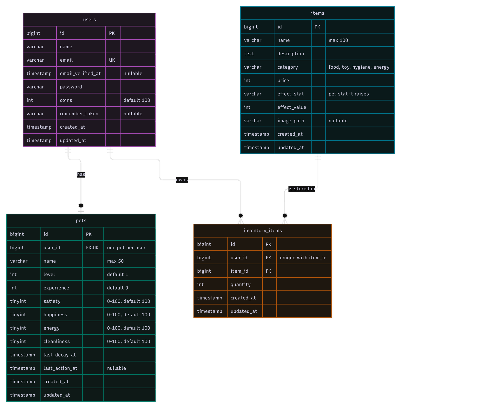

# PURIK

PURIK is a small pixel-art tamagotchi made with Laravel. You adopt a cat, take care of it, earn coins and spend them in the shop on food, toys, soap and energy drinks.

All the pictures (the cat, its moods, the items and the icons) are pixel art that I drew myself.

## How the game works

- Every player has **one cat**. On the first visit the player gives the cat a name.
- The cat has four needs, each from 0 to 100: **satiety, happiness, energy and cleanliness**.
- The needs go down while you are away: every 10 minutes satiety drops by 2 and the other needs by 1. This is calculated when you open the game, so no cron job is needed.
- There are four care actions:

    | Action | Effect                    |
    | ------ | ------------------------- |
    | Feed   | +20 satiety               |
    | Play   | +20 happiness, -15 energy |
    | Sleep  | +30 energy, -10 satiety   |
    | Clean  | +30 cleanliness           |

- Every action gives **10 XP and 5 coins**. After an action the cat rests for 60 seconds. If the cat does not need an action (the need is already 100), the action is refused and gives nothing.
- A level needs `level * 50` XP. Every new level gives a bonus of 50 coins.
- The cat's picture shows its mood. It depends on its lowest need: below 30 the cat is hungry, sad, tired or dirty; at 70 or more it is happy; otherwise it is normal.
- In the **shop** the player buys items with coins. Bought items go to the **inventory**. Every item raises one need, for example an apple gives +15 satiety. Items can be used from the inventory page or right on the game page.
- An **admin** can manage the shop: add new items, look at them, change them and delete them.

## Pages

| URL                                                               | Page                                                    | Who                   |
| ----------------------------------------------------------------- | ------------------------------------------------------- | --------------------- |
| `/`                                                               | Welcome page about the game                             | everyone              |
| `/login`, `/register`                                             | Log in and sign up                                      | guests                |
| `/pet/create`                                                     | Name your new cat                                       | players without a cat |
| `/game`                                                           | The cat, its needs, care actions and the items you own  | players               |
| `/shop`                                                           | Buy items                                               | players               |
| `/inventory`                                                      | Use your items on the cat                               | players               |
| `/items`                                                          | List of shop items (with create, show, edit and delete) | admin only            |
| `/settings/profile`, `/settings/security`, `/settings/appearance` | Account settings, password and light/dark theme         | players               |

## Database



- **users**: the players. `coins` is the player's money and `is_admin` marks the admin who can manage the shop.
- **pets**: the cats. `user_id` is unique, so every user has at most one cat (users 1-1 pets).
- **items**: everything that is sold in the shop. `effect_stat` is the need the item raises and `effect_value` is by how much.
- **inventory_items**: which items a user has and how many (`quantity`). A user has many inventory rows and an item can be in many inventories (users 1-N inventory_items, items 1-N inventory_items). The pair `user_id` + `item_id` is unique, so buying the same item again only raises the quantity.

## Built with

- Laravel 13 (PHP) and the Laravel React starter kit
- Inertia.js with React and TypeScript
- Tailwind CSS
- Laravel Fortify for login and registration
- SQLite
- Pest for the tests

## Installation

You need PHP 8.4 or newer, Composer and Node.js 22 or newer.

```bash
git clone https://github.com/pureheroky/purik.git
cd purik
composer install
npm install
cp .env.example .env
php artisan key:generate
php artisan migrate:fresh --seed
npm run build
php artisan serve
```

Then open http://localhost:8000.

`migrate:fresh --seed` creates the SQLite database, the shop items, an admin and five players with their cats.

| Email           | Password | Role                                                |
| --------------- | -------- | --------------------------------------------------- |
| admin@admin.com | password | admin, already has a cat named Purik and some items |

For development, `composer run dev` starts the Laravel server and Vite together.

## Tests

```bash
php artisan test
```

## Where to find things

| What                                                 | Where                                                                                               |
| ---------------------------------------------------- | --------------------------------------------------------------------------------------------------- |
| Routes                                               | `routes/web.php`, `routes/settings.php`                                                             |
| Controllers                                          | `app/Http/Controllers` (`PetController`, `ShopController`, `InventoryController`, `ItemController`) |
| Game rules (decay, actions, XP, buying, using items) | `app/Services`                                                                                      |
| Models                                               | `app/Models`                                                                                        |
| Migrations, factories, seeders                       | `database/`                                                                                         |
| Who can manage items                                 | `app/Providers/AppServiceProvider.php` (`manage-items` gate)                                        |
| Pages                                                | `resources/js/pages`                                                                                |
| Game components (stats, actions, cat)                | `resources/js/components/game`                                                                      |
| Layout with the sidebar                              | `resources/js/layouts/app-layout.tsx`, `resources/js/components/app-sidebar.tsx`                    |
| Pictures                                             | `public/images`                                                                                     |
